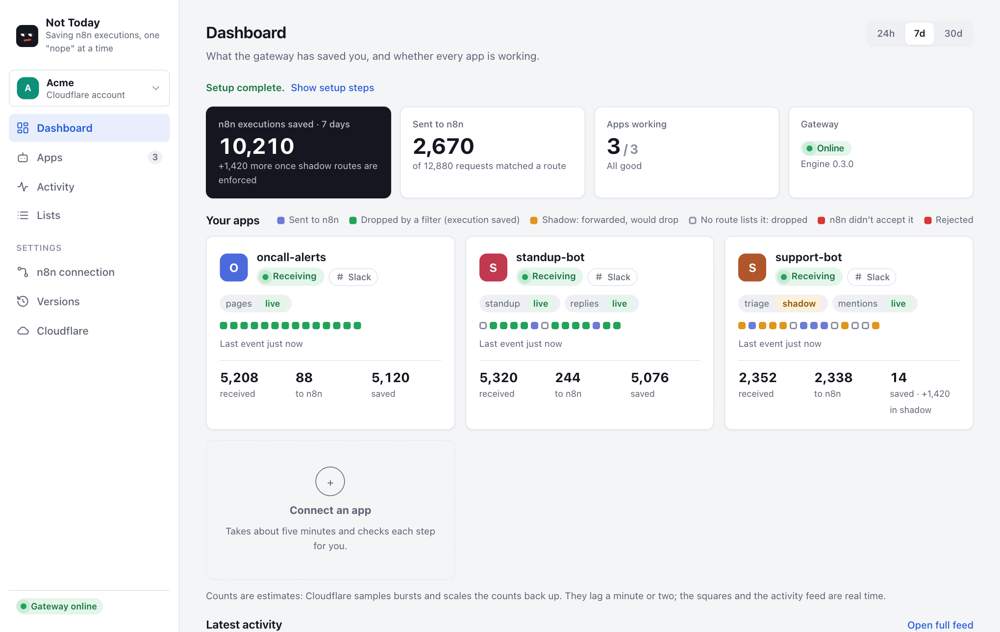
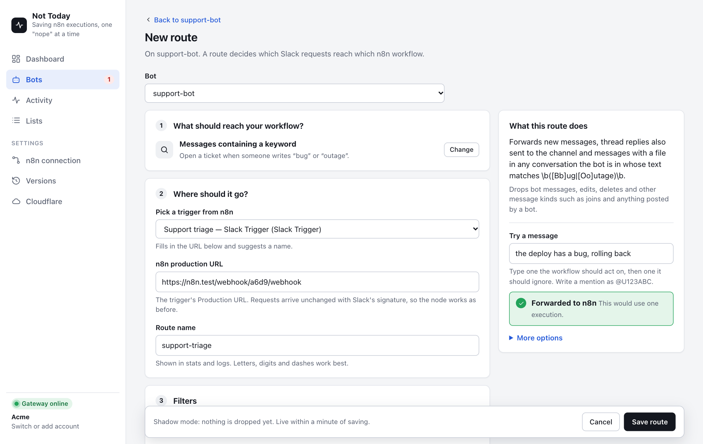
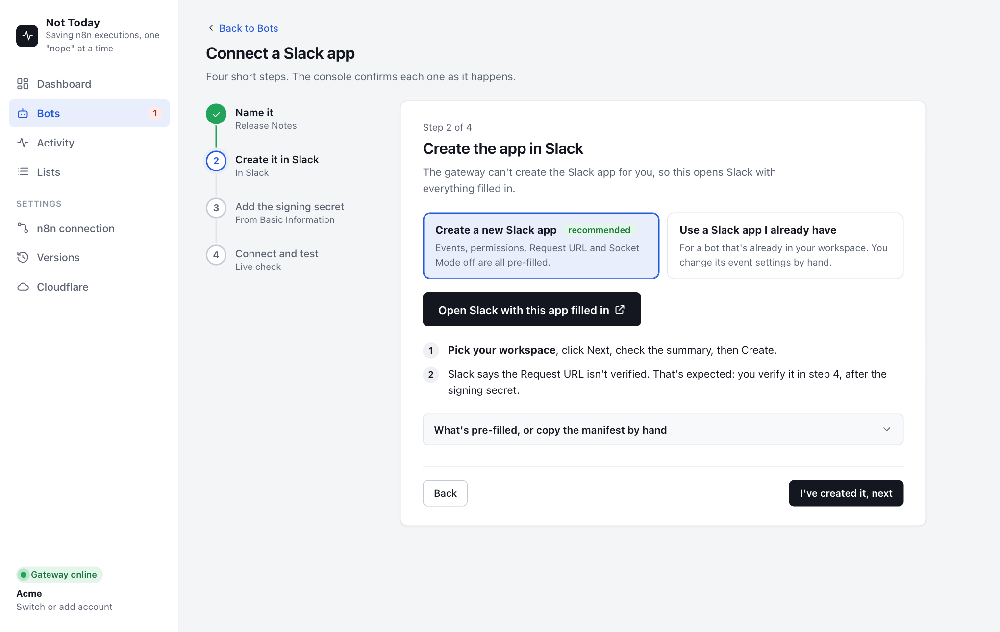

# Not Today

**Saving your n8n executions, one "nope" at a time.**

A Slack gateway for n8n. It says "not today" to every Slack request no workflow needs, so it never becomes an n8n execution. GitHub, Telegram and any webhook are [coming soon](#coming-soon-github-telegram-and-any-webhook).

n8n counts an execution every time a trigger fires. A Slack Trigger fires on every message, edit, reaction and bot post in every channel your Slack bot is in, even when the workflow only cares about a few of them and stops at its first check. A busy workspace can use most of a monthly execution quota this way.

This tool puts a small Cloudflare Worker between Slack and n8n. It checks Slack's signature, answers Slack at once, and forwards only the requests a workflow acts on. Everything it drops is an execution you don't pay for. It works for any Slack-triggered workflow: alerts, assistants, triage, slash commands, buttons.

```
Slack app ──► https://<your-worker>.workers.dev/slack/<app>
                 ├─ checks the signature, replies 200 to Slack right away
                 ├─ forwards matching requests to n8n, unchanged
                 └─ drops the rest (counted, never sent)
```

- **No n8n changes.** Requests are forwarded byte for byte with Slack's signature headers, so an existing Slack Trigger node keeps working as-is.
- **Free.** It runs on the Cloudflare Workers free plan (100,000 requests a day) in your own account.
- **Local console.** `npx nottoday` opens a web UI on your machine. Your tokens stay on your machine.



<table>
  <tr>
    <td></td>
    <td></td>
  </tr>
  <tr>
    <td align="center"><sub>Routes: try a message before saving</sub></td>
    <td align="center"><sub>Connecting a Slack app</sub></td>
  </tr>
</table>

## Quick start

You need a Cloudflare account (free), a Slack workspace where you can create or manage apps, and Node.js 22.4 or later.

```bash
npx nottoday
```

The console opens in your browser with a setup checklist that shows what's done and what's next:

1. **Connect Cloudflare.** A link opens Cloudflare's token page with the right permissions filled in. Paste the token back. You can save several Cloudflare accounts. Each one has its own gateway, with its own apps, routes and lists. The account switcher at the top of the sidebar changes which one you're working in, and flags the others when something needs a look. The Dashboard shows every account at a glance, the Apps page can list all their apps together, and *Connect an app* asks which gateway the new app goes to.
2. **Install.** One click creates the Worker, its settings store and its `workers.dev` address.
3. **Turn on stats** (optional, free). Cloudflare needs one Analytics Engine dataset; the console shows the exact name to use. Routing works without it.
4. **Connect n8n** (optional). Counts executions per workflow, so you can see which ones to fix, and lets you pick trigger URLs from a list.
5. **Connect a Slack app.** A four-step wizard. For a new app, one button opens Slack with everything filled in from a manifest: the gateway's Request URL, the events, the permissions, and Socket Mode off (with Socket Mode on, Slack never calls the URL). You paste the Signing Secret, click Verify in Slack, and a **live check** confirms each step within seconds: URL verified, first event arrived, signatures OK. For an existing app, the wizard gives you a checklist instead; save its old Request URL first, since putting it back is your rollback.
6. **Add a route.** Pick what should reach the workflow (mentions of people on a list, DMs to the bot, a channel, a keyword, a slash command…), pick the workflow, and check the route in plain words. Filters that take a list of people or channels let you choose a saved list or create one right there, typed or copied from an n8n data table, without leaving the route. **Try a message** shows whether a sample message would be forwarded or dropped, using the gateway's own logic. Routes start in **shadow** mode, which forwards everything and records what it *would* drop.
7. **Check, then enforce.** Send a few test requests and watch the squares on the app's card (or the **Activity** page), which show each decision as it happens. When the drops are right, open the app and click **Switch to enforce**.

## Common uses

| Your workflow | Route to set up | What the gateway drops |
|---|---|---|
| Alerts when certain people are mentioned (on call, managers, account owners) | Messages that mention someone on a list | Every message that doesn't mention them, edits, bot posts |
| An assistant that answers DMs | Direct messages to the bot | All channel traffic, the bot's own replies |
| A bot that replies when @mentioned | Mentions of the bot | Everything else the Slack Trigger was subscribed to |
| Triage of a support or requests channel | New messages in specific channels | Other channels, edits, joins |
| Tickets from keywords ("bug", "outage") | Messages containing a keyword | Messages without the keyword |
| Slash commands, approval buttons, modal forms | A slash command / button clicks | Nothing extra; you still get one place to see and route them |

The route editor offers each of these as a starting point. One Slack app can feed several workflows: a message that matches two routes goes to both.

## Coming soon: GitHub, Telegram and any webhook

The gateway already handles these, and the console has a connect flow for each, but they can't be picked in the console yet while they get tested against real repositories and bots. Here's how they will work.

Each app gets its own address on the gateway, and its own secret, stored as a Worker secret.

| App | Address | How requests are checked | Connecting it |
|---|---|---|---|
| GitHub | `/github/<app>` | `X-Hub-Signature-256` with a secret the console generates | Add a webhook in the repository or organization settings: Payload URL, content type `application/json`, the secret. GitHub's ping shows up in the live check. |
| Telegram | `/telegram/<app>` | The secret token Telegram sends with every update | Paste the bot token from BotFather once. The console points the bot at the gateway with a fresh secret token; the bot token isn't saved. |
| Any webhook | `/hook/<app>` | An HMAC signature (hex or base64, any header), a secret header, or a secret in the URL | Presets for GitHub-style signatures, Shopify, Linear, Typeform and GitLab, or set it up yourself. |

**In n8n, start these workflows with a Webhook node (POST), not n8n's GitHub or Telegram trigger.** Those triggers register their own webhook with GitHub or Telegram, which goes around the gateway. Telegram allows only one webhook per bot, so an active Telegram Trigger even takes it back.

Routes for these apps pick events by name (GitHub's `push` or `pull_request`, Telegram's `message` or `callback_query`, a webhook's event field) and add **conditions** on any field of the request: is, is not, is one of (a saved list or typed values), matches a pattern, is present, is missing. Starting points:

| App | Templates |
|---|---|
| GitHub | Pushes to a branch (not by bots), pull requests opened or merged, new issues, comments from people, failed workflow runs, published releases |
| Telegram | Messages to the bot, a bot command, group messages that mention the bot, button presses |
| Any webhook | Only when a field matches, or everything |

**Try a payload** checks a pasted request body against the route with the gateway's own code. GitHub keeps recent deliveries under Settings → Webhooks, which makes good test material.

## The one rule

**A route's filters must be at least as loose as the workflow's own checks.** The gateway may forward something the workflow then ignores. It must never drop something the workflow would act on.

That's why routes start in shadow mode. It's also why lists, such as who's on call, can be copied from an n8n data table instead of typed in. A list that falls behind the table drops real messages. Refresh it from the **Lists** tab whenever the table changes.

## What a route can filter

| Filter | Example use |
|---|---|
| Must mention someone in a list | Only when someone on call is mentioned |
| Must mention someone / ignore self-mentions | Mentions of anyone, not counting people mentioning themselves |
| Message kinds | New messages and thread broadcasts, not edits, deletes or joins |
| Ignore bot posts | Skip messages from bots and integrations |
| Channel types, channels, senders | Only DMs; never #random; only from certain users |
| Text pattern | A regular expression the message must match |

Routes can also match button clicks, modals and slash commands. For those, choose "wait for n8n's reply" when the workflow answers Slack directly.

## Rollback

Put the old n8n URL back in the Slack app's Event Subscriptions. The workflow was never changed, so it works as before straight away. Config changes can also be undone from **Versions**: every save keeps the version it replaced.

## Behaviour details

- **Signatures:** every request is checked with the app's signing secret and must be under 5 minutes old; otherwise the gateway answers 401.
- **Slack retries:** Slack re-sends an event it didn't get a 2xx for. The gateway can't tell "we already handled it but the reply was lost" from "it never reached us", and dropping the second kind would lose the event silently. So every retry is processed like a first delivery, and its retry number and reason are logged. In rare cases that means a duplicate; a workflow that must not run twice should check the event ID.
- **n8n unavailable:** on 502, 503, 504 or a network error the gateway tries twice more (after 0.5 s, then 1.5 s). Other errors aren't retried, so a retry is unlikely to run a workflow twice.
- **Logs and stats:** event type, subtype, channel ID and the routing decision. Never message text.

## Where things are stored

| What | Where |
|---|---|
| Cloudflare API tokens (one per saved account), n8n API key | Your machine: `~/.config/nottoday/state.json` (an existing `~/.config/slack-gateway` from before the rename is still used), readable only by your user |
| Slack signing secrets | Cloudflare, as Worker secrets. Not on your machine, and never in the config |
| Routes, lists, config history | Cloudflare KV, in your account |
| Counts of forwarded and dropped requests | Cloudflare Analytics Engine, in your account (kept 3 months). Message text is never recorded. Cloudflare samples bursts of requests, so counts are estimates, exact only at steady light volume |

The console listens on `127.0.0.1` only, unless you [run it on a server](#running-the-console-on-a-server). Every API call needs the session token from the link the CLI prints. See [SECURITY.md](SECURITY.md).

## If your computer is lost or replaced

The gateway keeps running on Cloudflare, so Slack and your other apps keep working. Your apps, routes, lists, version history and secrets are all in your Cloudflare account. Only your Cloudflare token and n8n key were on the old computer. To manage everything again from another one:

1. Run `npx nottoday`.
2. Create a new Cloudflare token and paste it in. If the old computer might be in someone else's hands, revoke the old token in Cloudflare (My Profile → API Tokens).
3. On *Install the gateway*, the console lists the gateway that's already in the account. Click **Reconnect**. Nothing is deleted; the gateway is updated to the newest engine and your apps come back.
4. Connect n8n again with its address and API key.

## Running the console on a server

You don't need a server. The gateway runs on Cloudflare and keeps routing when the console is closed, so the usual way is to run `npx nottoday` on your laptop when you want to change something.

If you'd rather manage it from an always-on machine, such as a VPS, run the console there (Node.js 22.4 or later) in one of two ways.

**Directly, over HTTPS:**

```bash
npx nottoday --host 0.0.0.0
```

It prints a link like `https://203.0.113.5:4870/#t=…`. The console makes its own self-signed certificate, so the browser warns the first time; check that the certificate's SHA-256 fingerprint matches the one printed, then continue. The certificate is kept, so the warning doesn't come back on every start.

- Open the port (4870, or your `--port`) in the server's firewall.
- To use a domain name instead of the IP address, add `--allow-host console.example.com`. With a real certificate for it, add `--cert fullchain.pem --key privkey.pem` and the browser won't warn.
- `--insecure-http` turns HTTPS off. Then anyone on the network path can read the link's token and use the console, so keep it for networks you trust.

**Through Tailscale, private to your devices:**

```bash
npx nottoday --tailscale
```

The console stays on `127.0.0.1`, and `tailscale serve` shares it at `https://<machine>.<tailnet>.ts.net` with a real certificate. Only devices signed in to your tailnet can reach it, and no port is opened to the internet. It needs Tailscale running on the server (`tailscale up`) and on the device you browse from, with MagicDNS and HTTPS certificates turned on for the tailnet. On Linux, if `tailscale serve` says access denied, run `sudo tailscale set --operator=$USER` once. The share stops when the console stops.

In both modes:

- The link's token is the key to the console. It's kept between starts, so a bookmarked link keeps working; `--new-token` replaces it, and old links stop working.
- Your Cloudflare and n8n tokens are saved on the server, in `~/.config/nottoday/state.json` of the user running the console. Use a machine you trust as much as your laptop.
- To keep it running after you log out, start it in `tmux` or as a systemd service.

An SSH tunnel works too, with no flags: run `npx nottoday --no-open` on the server, `ssh -N -L 4870:127.0.0.1:4870 you@your-server` on your machine (same port on both ends), and open the printed link.

## Development

```
packages/shared    config types, validation, stats layout (used by both)
packages/engine    the Worker
packages/console   CLI, local API server, web UI
```

```bash
npm install
npm run check                    # type-check and tests for all packages
npm run build -w nottoday        # engine bundle + UI + CLI into packages/console/dist
node packages/console/dist/cli.js
```

Engine, locally in workerd, without Cloudflare:

```bash
cd packages/engine
cp .dev.vars.example .dev.vars   # FORWARD_DRY_RUN=true: nothing is sent to n8n
npm run dev:seed                 # writes examples/dev.config.json to local KV
npm run dev
```

Console UI with hot reload: run `npm run dev -w nottoday` (API on port 4870) and `npm run dev:web -w nottoday` (UI on port 5173) in two terminals.

## License

Apache License 2.0. See [LICENSE](LICENSE).
