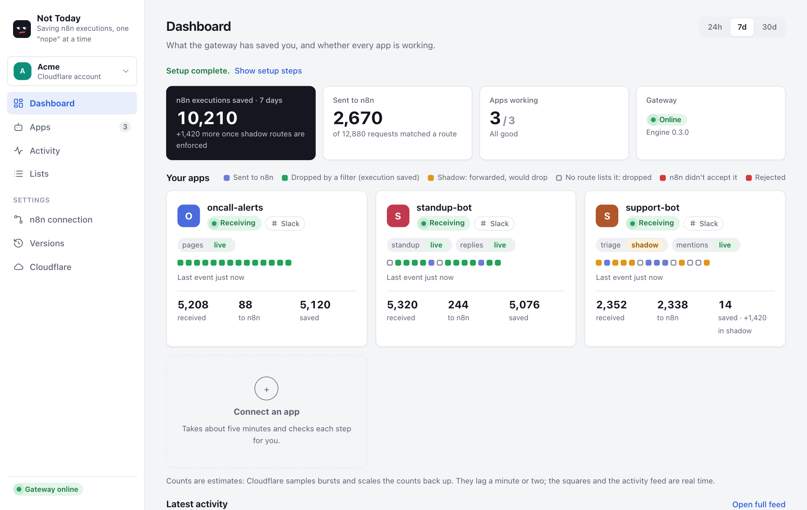

# Not Today

**Saving your n8n executions, one "nope" at a time.**

n8n counts an execution every time a trigger fires, and a Slack Trigger fires on every message, edit, reaction and bot post in every channel your bot is in. Not Today puts a small Cloudflare Worker between Slack and n8n that forwards only the requests a workflow acts on. Everything it drops is an execution you don't pay for.



```bash
npx nottoday
```

This opens a local web console (on 127.0.0.1; see the full README for running it on a server) that installs the gateway into your own Cloudflare account, connects your Slack apps, and sets up routes. Your tokens stay on your machine, and message text is never logged.

You need Node.js 22.4 or later, a Cloudflare account (the free plan is enough), and a Slack workspace where you can create or manage apps.

Full documentation, security notes and source: https://github.com/sigitkusuma/nottoday

Licensed under the Apache License 2.0.
